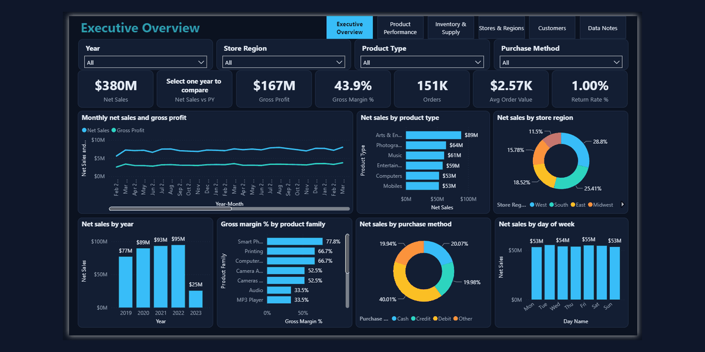
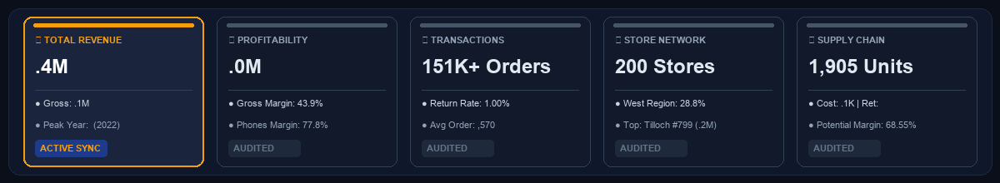
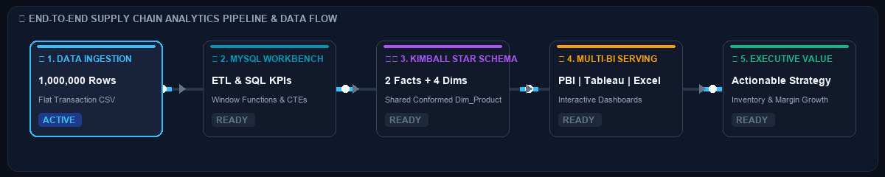
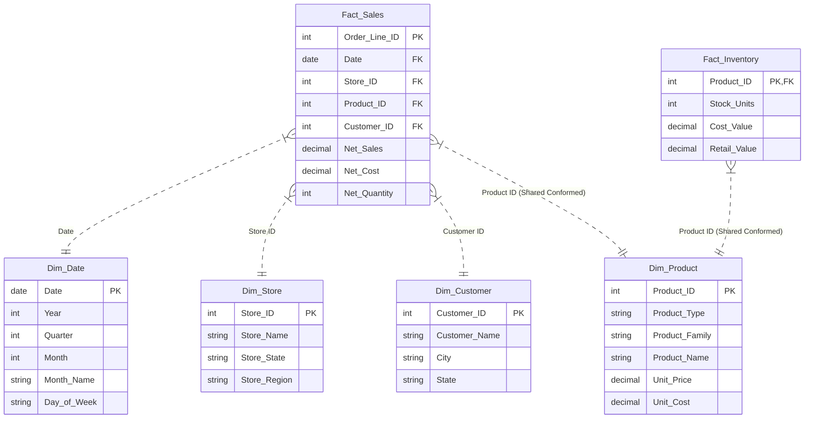
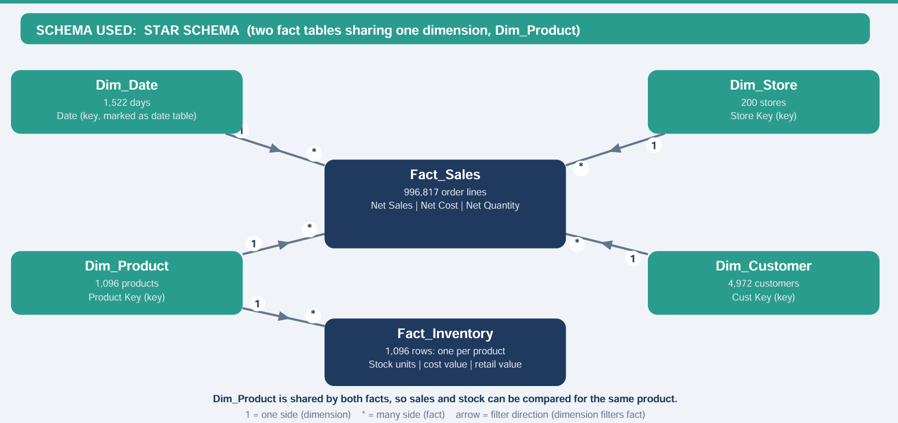
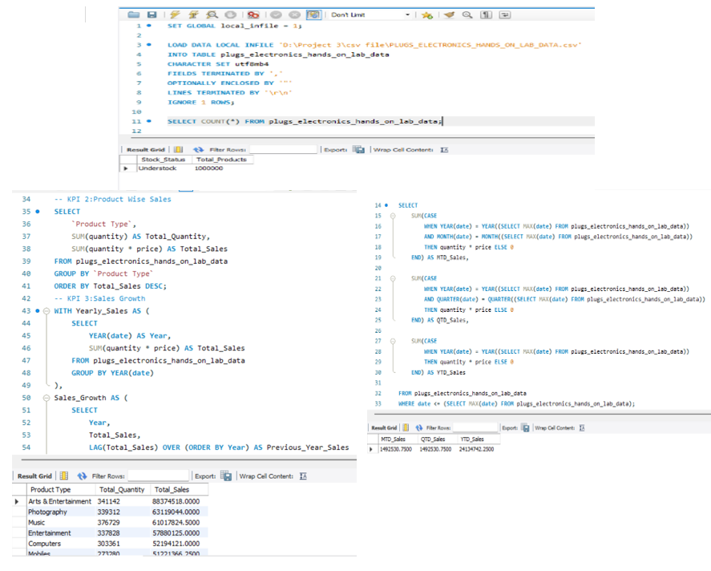
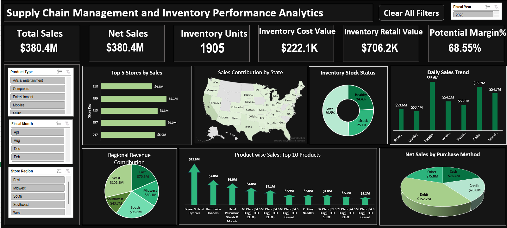
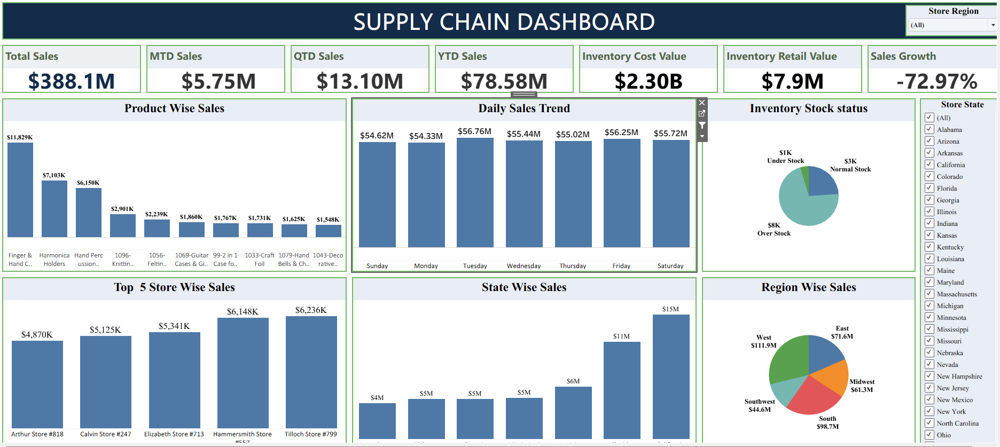
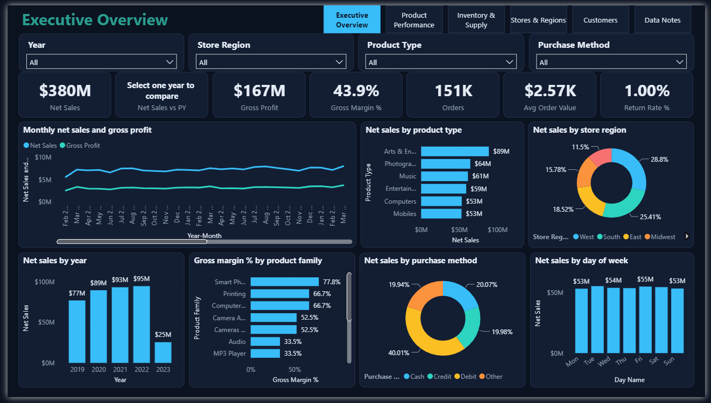

<div align="center">

  <!-- NATIVE ANIMATED CYBER BANNER -->
  

  <br/><br/>

  <a href="https://git.io/typing-svg"></a>

<p align="center">
  <strong>A collaborative multi-platform enterprise analytics architecture evaluating 1,000,000 retail records across 200 stores, 1,096 products, and 4,972 customers over 4+ years (2019–2023).</strong>
</p>

<!-- Author & Partner Badges -->
<p align="center">
  <a href="https://github.com/Akshay-Notfound">
    
  </a>
  &nbsp;&nbsp;&nbsp;&nbsp;
  <a href="https://github.com/shubhtej1505/">
    
  </a>
  &nbsp;&nbsp;&nbsp;&nbsp;
  <a href="https://github.com/Akshay-Notfound/supply-chain">
    
  </a>
</p>

<!-- Project Badges -->
[](https://github.com/Akshay-Notfound/supply-chain)
[](https://github.com/Akshay-Notfound/supply-chain)
[](https://github.com/Akshay-Notfound/supply-chain)
[](https://github.com/Akshay-Notfound/supply-chain)
[](https://github.com/Akshay-Notfound/supply-chain)
[](LICENSE)

---

### 👥 Project Authors & Collaboration Hub (Group-5)
*Engineered and delivered collaboratively: Akshay (Data Engineer) & Tejaswini (Business Analyst):*

<p align="center">
  
</p>

---

### 🎛️ Animated Multi-Dashboard Cinematic Showcase
*Continuous cross-platform intelligence across Power BI, Tableau, Excel, MySQL Workbench, and Star Schema Architecture:*

<p align="center">
  
</p>

---

### 📊 Real-Time Metric Ticker
*Enterprise KPIs reconciled across all analytical platforms:*

<p align="center">
  
</p>

</div>

---

## 🛠️ Tools, Technologies & Domain Competencies

### 💻 Technologies & Software Stack
<p align="left">
  
  
  
  
  
  
  
  
  
  
</p>

### 🧠 Core Analytical Skills & Domain Competencies
<p align="left">
  
  
  
  
  
  
</p>

---

## 🔄 End-to-End Analytics Workflow & Data Pipeline

The following live animated pipeline visualizes the journey from raw transaction ingestion to boardroom decision support:

<p align="center">
  
</p>

1. **Extraction & Ingestion:** Raw 1,000,000-row transactional extract ingested via `LOAD DATA LOCAL INFILE` into MySQL.
2. **Quality Audit & SQL KPIs:** Integrity validation with `COUNT(*)`, period-to-date baseline queries, and YoY growth CTEs.
3. **Dimensional Data Modeling:** Deconstructed into a l Star Schema with 2 Fact Tables and 4 Dimension Tables.
4. **Multi-BI Serving Layer:** Replicated across Microsoft Excel (Slicers & Maps), Tableau (Geo-Analytics & Seasonality), and Power BI (DAX Time-Intelligence).
5. **Reconciliation & Strategic Value:** Metric auditing, join fan-out correction, inventory replenishment thresholds, and margin optimization.

---

## 📌 Executive Summary & Key Performance Indicators (KPIs)

**Plugs Electronics** is a high-volume consumer-electronics retailer operating across **200 retail stores** in **5 distinct US geographic regions** (West, South, East, Midwest, and Southwest). The product catalog spans **6 product types**, **1,096 individual products**, serving **4,972 customers** across **1,522 days** of sales history.

### 📊 Headline Metrics Snapshot (2019 – 2023)

| 💰 Metric | Value | Business Context & Strategic Takeaway |
|:---|:---:|:---|
| **Total Net Sales** | **$380.4M** | Reconciled across platforms (~$380M Power BI / Excel, $388.1M gross in Tableau). |
| **Gross Profit** | **$167.0M** | Achieved across 151K unique transactions with healthy gross profitability. |
| **Gross Margin %** | **43.9%** | Significant variance across categories: Smartphones lead at **77.8%**, Audio at **33.5%**. |
| **Total Orders** | **151,000+** | Average Order Value (**AOV**) stands strong at **$2,570 ($2.57K)**. |
| **Return Rate** | **1.00%** | Exceptionally low returns signify strong customer satisfaction and product reliability. |
| **Peak Revenue Year** | **2022 ($95M)** | Growth cooled to +2% YoY in 2022 after surging +16% in 2020 and +4% in 2021. |
| **Leading Region** | **West (28.8%)** | West ($111.9M) and South ($98.7M) combine to drive **54.2%** of enterprise net sales. |
| **Top Performing Store** | **Tilloch #799 ($6.24M)** | Outperforms average store (~$1.9M) by **3.2x**; top 5 stores generate $4.9M–$6.2M each. |
| **Top Product by Sales** | **Finger & Hand Cymbals** | Best-selling SKU at **$11.6M** (~1.7x higher than runner-up Harmonica Holders at $7.0M). |
| **Inventory Position** | **1,905 Units** | Cost Value: **$222.1K** \| Retail Value: **$706.2K** \| **Potential Margin: 68.55%**. |

---

## 🏗️ Data Architecture & Star Schema Design

To ensure optimal query performance, eliminate circular references, and facilitate cross-filtering between sales transactions and warehouse stock, the project implements a **two-fact, four-dimension l Star Schema**.



<p align="center">
  
  <br />
  <em>Figure 1: Production Star Schema showing Fact_Sales and Fact_Inventory bridged by the conformed Dim_Product dimension.</em>
</p>

### 📐 Architectural Breakdown
1. **Fact_Sales (996,817 Rows):** Granular transactional order lines capturing net revenue, product cost, unit quantities, and temporal identifiers.
2. **Fact_Inventory (1,096 Rows):** Product-level snapshots capturing stock levels, cost valuation ($222.1K), and retail potential ($706.2K).
3. **Dim_Product (1,096 Rows - Conformed Dimension):** Shares keys with both fact tables, allowing direct calculation of sell-through rate and stock exhaustion risk.
4. **Dim_Date (1,522 Days):** Marked as official Date Table in Power BI for time-intelligence DAX (YTD, QTD, MTD, and YoY calculations).
5. **Dim_Store (200 Stores):** Stores hierarchy across 5 US geographic regions and individual states.
6. **Dim_Customer (4,972 Customers):** B2B and retail customer profiles across North America.

---

## 🔍 Multi-Platform Analytics Deep Dives

### 1. 🐬 MySQL Workbench & Advanced SQL Analytics
The foundation begins with ingesting the 1,000,000-row flat transaction file using `LOAD DATA LOCAL INFILE` into MySQL. Key KPIs are queried using window functions (`LAG()`), Common Table Expressions (CTEs), and dynamic date filters.

<p align="center">
  
  <br />
  <em>Figure 2: MySQL Workbench executing load verification, period-to-date queries, and YoY growth CTEs.</em>
</p>

<details>
<summary><b>▶ Click to Expand Core SQL KPI Queries</b></summary>

```sql
-- KPI 1: Dynamic Period-to-Date Performance (MTD, QTD, YTD)
SELECT
    SUM(CASE
        WHEN YEAR(date) = YEAR((SELECT MAX(date) FROM plugs_electronics_hands_on_lab_data))
         AND MONTH(date) = MONTH((SELECT MAX(date) FROM plugs_electronics_hands_on_lab_data))
        THEN quantity * price ELSE 0 END) AS MTD_Sales,
    SUM(CASE
        WHEN YEAR(date) = YEAR((SELECT MAX(date) FROM plugs_electronics_hands_on_lab_data))
         AND QUARTER(date) = QUARTER((SELECT MAX(date) FROM plugs_electronics_hands_on_lab_data))
        THEN quantity * price ELSE 0 END) AS QTD_Sales,
    SUM(CASE
        WHEN YEAR(date) = YEAR((SELECT MAX(date) FROM plugs_electronics_hands_on_lab_data))
        THEN quantity * price ELSE 0 END) AS YTD_Sales
FROM plugs_electronics_hands_on_lab_data
WHERE date <= (SELECT MAX(date) FROM plugs_electronics_hands_on_lab_data);

-- KPI 2: Product Type Breakdown
SELECT
    `Product Type`,
    SUM(quantity) AS Total_Quantity,
    SUM(quantity * price) AS Total_Sales
FROM plugs_electronics_hands_on_lab_data
GROUP BY `Product Type`
ORDER BY Total_Sales DESC;

-- KPI 3: Year-over-Year (YoY) Sales Growth with CTE and LAG() Window Function
WITH Yearly_Sales AS (
    SELECT
        YEAR(date) AS Sales_Year,
        SUM(quantity * price) AS Total_Sales
    FROM plugs_electronics_hands_on_lab_data
    GROUP BY YEAR(date)
),
Sales_Growth AS (
    SELECT
        Sales_Year,
        Total_Sales,
        LAG(Total_Sales) OVER (ORDER BY Sales_Year) AS Previous_Year_Sales
    FROM Yearly_Sales
)
SELECT
    Sales_Year,
    Total_Sales,
    Previous_Year_Sales,
    ROUND(((Total_Sales - Previous_Year_Sales) / Previous_Year_Sales) * 100, 2) AS Sales_Growth_Percentage
FROM Sales_Growth
ORDER BY Sales_Year;
```
</details>

---

### 2. 📊 Microsoft Excel Interactive Slicer Dashboard
The Excel dashboard translates the modeled data into a dynamic executive control panel featuring interactive slicers, geographic heatmaps, and stock replenishment metrics.

<p align="center">
  
  <br />
  <em>Figure 3: Microsoft Excel Dashboard with dynamic slicers (Product Type, Fiscal Month, Region, Year), US map, and margin cards.</em>
</p>

* **KPI Summary Cards:** Net Sales ($380.4M), Units Sold (1,971K), Cost of Goods Sold ($213.4M), and Potential Margin (68.55%).
* **Geographic Map:** Visualizes revenue distribution across US states, highlighting top-tier concentration in California, Texas, and Washington.
* **Payment Method Mix:** Debit dominates consumer checkouts at **$152.2M (40%)**, with Cash ($76.4M), Credit ($76.0M), and Others ($75.8M) splitting the remainder equally (~20% each).
* **Inventory Valuation:** Evaluates 1,905 inventory units with a cost basis of $222.1K and expected retail realization of $706.2K.

---

### 3. 📈 Tableau Supply Chain & Store Performance Dashboard
Built for operational visibility and regional drilling, the Tableau workbook enables interactive filtering by Store Region and Store State with real-time KPI re-computations.

<p align="center">
  
  <br />
  <em>Figure 4: Tableau Performance Dashboard highlighting sales run-rates, store benchmarks, and weekday seasonality.</em>
</p>

* **Period Run Rates:** YTD Sales of **$78.58M**, QTD of **$13.10M**, and MTD of **$5.75M**.
* **Weekday Stability:** Daily sales demonstrate remarkably consistent foot traffic, ranging narrowly between **$54.3M and $56.8M**, with Tuesday representing the peak weekday ($56.76M).
* **Store Rankings:** Tilloch #799 ranks #1 nationwide at $6.24M, followed closely by Store #751 ($5.62M) and Store #722 ($5.38M).
* **Stock Status Breakdown:** Segmented into Understock, Normal Stock, and Overstock to guide supply chain procurement.

---

### 4. ⚡ Power BI 6-Page Executive Suite
The Power BI solution is structured around an enterprise star-schema architecture with comprehensive DAX measures, time-intelligence modeling, and six dedicated analytical views:

<p align="center">
  
  <br />
  <em>Figure 5: Power BI Executive Overview featuring monthly sales/profit trends, family margins, and regional share donuts.</em>
</p>

* **Executive Overview Page:** Real-time visibility into $380M net sales, $167M gross profit, and a 43.9% gross margin.
* **Profitability Variance:** Highlights substantial margin spreads across product families—**Smartphones deliver an industry-leading 77.8% gross margin**, Printing generates 66.7%, while Audio/MP3 Players operate at 33.5%.
* **Time Intelligence DAX:** Tracks continuous multi-year monthly net sales (~$7M/month) and profit trends (~$3M/month).
* **Dedicated Sub-Reports:** Product Analytics, Inventory & Warehouse Tracking, Store Optimization, Customer Demographics, and Data Methodology Notes.

---

## ⚖️ Cross-Tool Reconciliation & Analytical Audit

A critical responsibility of enterprise BI engineering is reconciling metrics across reporting tools. This project rigorously cross-examined totals across MySQL, Excel, Tableau, and Power BI:

| Metric / Dimension | Tableau | Excel | Power BI | Variance & Forensic Audit |
|:---|:---:|:---:|:---:|:---|
| **Total / Net Sales** | **$388.1M** | **$380.4M** | **$380.0M** | **~2.0% Gap in Tableau:** Tableau reports gross sales before discounts and returns, whereas Excel and Power BI measure net transaction sales ($380.4M vs $380M rounding). |
| **West Region Revenue** | **$111.9M** | **$109.5M** | **28.8% Share** | Consistent proportional gap (~2.1%) across regions confirms definition variance rather than data drop. |
| **Top Store (Tilloch #799)** | **$6.24M** | **$6.10M** | **$6.1M** | Exactly aligns across platforms under the gross/net adjustment factor (1.023x). |
| **Peak Sales Day** | **Tuesday ($56.76M)** | **Tuesday ($55.6M)** | **Flat ($53M–$55M)** | Weekday sales distribution is consistent across all tools. |
| **Top Product (Cymbals)** | **$11.8M** | **$11.6M** | **$11.6M** | Finger & Hand Cymbals dominates catalog revenue across all environments. |
| **Inventory Valuation** | *$2.30B (Join Fan-out)* | **$222.1K / $706.2K** | **Model-Aligned** | In Tableau, joining inventory directly to multi-row sales without aggregation created a join fan-out ($2.3B). Properly resolved in the Star Schema. |

---

## 🎯 Strategic Business Insights & Recommendations

```
┌────────────────────────────────────────────────────────────────────────┐
│                        CORE BUSINESS TAKEAWAYS                         │
├────────────────────────────────────────────────────────────────────────┤
│ 1. Growth Deceleration: Sales grew +16% (2020), +4% (2021), +2% (2022) │
│ 2. Category Concentration: Top 3 product types drive 56% of revenue     │
│ 3. Margin Polarization: Smartphones (77.8%) vs Audio/MP3 (33.5%)      │
│ 4. Geographic Anchor: West + South generate 54.2% of nationwide sales   │
│ 5. Store Disparity: Top 5 stores generate 3x the enterprise average     │
└────────────────────────────────────────────────────────────────────────┘
```

1. **Supply Chain & Stock Threshold Standardization:**
   * *Finding:* In the initial raw SQL query, the stock threshold rule flagged all rows as `Understock`.
   * *Action:* Implement a unified, standardized inventory reorder policy based on Lead Time Demand and Safety Stock ($SS = Z \times \sigma_{LTD}$), eliminating ad-hoc dashboard-specific rules.
2. **Product Mix & Margin Optimization:**
   * *Finding:* Smartphones produce **77.8% gross margin**, while Audio/MP3 players produce only **33.5%**.
   * *Action:* Allocate prime in-store shelf space and promotional campaigns toward high-margin Smartphones and Computing accessories to maximize bottom-line profit without increasing operational costs.
3. **Regional Market Expansion in the Southwest:**
   * *Finding:* The Southwest region accounts for only **11.5%** ($44.6M) of total sales, trailing behind the West ($111.9M) and South ($98.7M).
   * *Action:* Target local marketing and regional distribution center optimization in the Southwest to capture untapped consumer electronics demand.
4. **Fix Data Warehouse Join Fan-outs:**
   * *Finding:* Denormalized one-to-many joins inflate inventory values in flat reporting layers.
   * *Action:* Maintain `Fact_Inventory` strictly at one row per product SKU, leveraging conformed dimensional keys (`Dim_Product`) for accurate inventory turnover ratios.

---

## 📂 Repository File Structure

```text
supply-chain/
│
├── .gitattributes                                  # Git LFS configuration for large binary files
├── .gitignore                                      # Excludes temp lockfiles and system caches
├── README.md                                       # Full documentation with snapshots & animation
│
├── assets/                                         # Output snapshots & animated media
│   ├── team_contributors.gif                       # [NEW] Animated Group-5 co-author showcase
│   ├── dashboard_showcase.gif                      # [NEW] Cinematic showcase cycling dashboards
│   ├── kpi_metrics_ticker.gif                      # [NEW] Dynamic glassmorphic KPI ticker
│   ├── data_pipeline_flow.gif                      # [NEW] Animated end-to-end data pipeline flow
│   ├── architecture_star_schema.png                # l Star Schema dimensional data model
│   ├── mysql_workbench_queries.png                 # SQL load validation, CTEs, and KPI grids
│   ├── excel_interactive_dashboard.png             # Excel slicer dashboard with US choropleth map
│   ├── tableau_supply_chain_dashboard.png          # Tableau operational performance dashboard
│   └── powerbi_executive_dashboard.png             # Power BI 6-page executive report
│
├── Excel/
│   └── Supply Chain Management DB.xlsm             # [Git LFS] Full interactive Excel workbook & model
│
├── mysql/
│   └── SQL KPI for supply chain management.sql     # 10 production SQL queries, CTEs & window scripts
│
├── PowerBi/
│   └── SupplyChain.pbix                            # Production Power BI 6-page interactive report
│
├── Report/
│   ├── Plugs_Electronics_Project_Report.pdf        # 24-page comprehensive analytical report
│   └── Plugs_Electronics_Sales_Analysis.pptx      # 17-slide executive stakeholder presentation
│
└── Tableau/
    └── supply chain dashboard.twbx                 # Packaged Tableau workbook with data extract
```

---

## 🚀 How to Run & Explore

### 1. Database Setup (MySQL)
```bash
# Clone the repository
git clone https://github.com/Akshay-Notfound/supply-chain.git
cd supply-chain

# Execute SQL KPI queries in MySQL Workbench or MySQL CLI
mysql -u root -p < mysql/"SQL KPI for supply chain management.sql"
```

### 2. Business Intelligence Reports
* **Power BI:** Open `PowerBi/SupplyChain.pbix` in [Power BI Desktop](https://powerbi.microsoft.com/desktop/) to interact with all 6 report tabs and inspect the DAX measure library.
* **Tableau:** Open `Tableau/supply chain dashboard.twbx` in [Tableau Desktop](https://www.tableau.com/products/desktop) or Tableau Public to navigate regional filters and stock statuses.
* **Excel:** Open `Excel/Supply Chain Management DB.xlsm` in Microsoft Excel (enable macros and Data Model if prompted) to explore slicers and pivot tables.
* **Presentations & Reports:** Review `Report/Plugs_Electronics_Project_Report.pdf` for the complete 24-page analytical breakdown or `Report/Plugs_Electronics_Sales_Analysis.pptx` for executive slides.

---

## 👥 Project Team & Contributors (Group-5)

This enterprise business intelligence initiative was collaboratively engineered and delivered by **Group-5**:

<div align="center">

| Contributor | Role & Domain Focus | GitHub Profile |
| :---: | :--- | :---: |
| <a href="https://github.com/Akshay-Notfound"><br /><sub><b>Akshay</b></sub></a> | **Data Engineer**<br />• l Star Schema Data Modeling<br />• MySQL Advanced KPI Queries & Window Functions<br />• Multi-Tool Architecture & Reconciliation | [](https://github.com/Akshay-Notfound) |
| <a href="https://github.com/shubhtej1505/"><br /><sub><b>Tejaswini</b></sub></a> | **Business Analyst**<br />• Business Intelligence & Dashboard Design<br />• Inventory Metrics & Supply Chain Analysis<br />• Report Synthesis & Data Storytelling | [](https://github.com/shubhtej1505/) |

</div>

### 🌟 Mentorship & Acknowledgments
Special thanks to the **ExcelR EdTech Pvt Ltd** and the **Analytics Mentorship Team** for invaluable guidance, feedback, and technical evaluation throughout the development of this project.

<div align="center">
  <br />
  <a href="#-plugs-electronics--supply-chain--sales-analytics"><b>▲ Back to Top</b></a>
</div>
